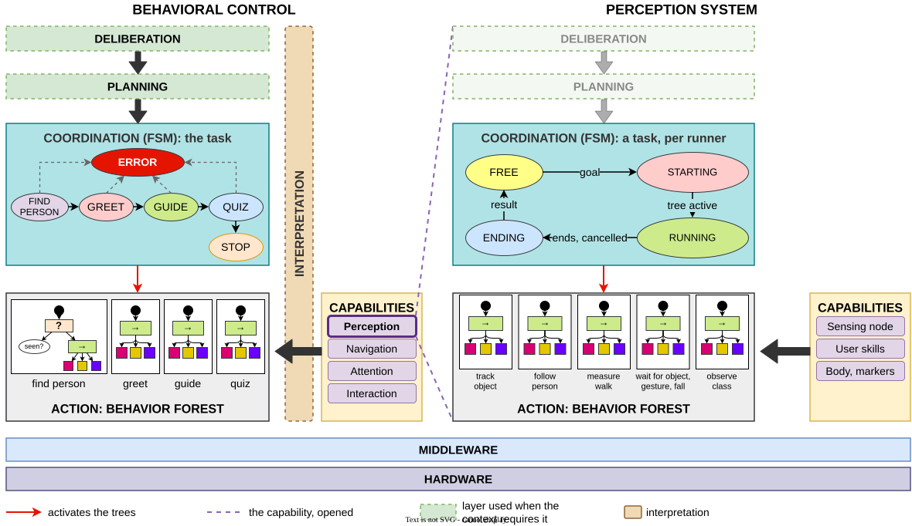
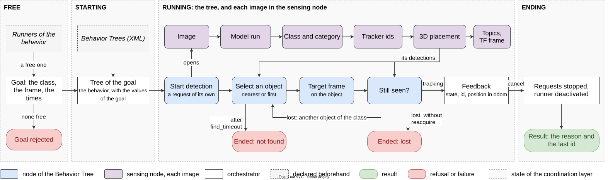
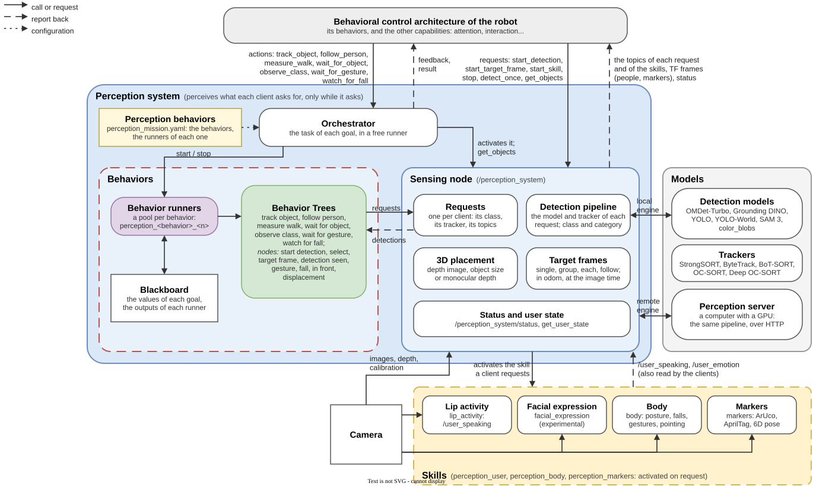

# perception_system


The **perception capability of a robot**, built on ROS 2 Jazzy (and on ROS 2 Lyrical with pixi)
and on [`koch2`](https://github.com/geriabot/koch2) (formerly `behavior_architecture`).

The behaviors of a robot, and its other capabilities, need to know what is around it: the person
the attention system keeps in view, whether the user is speaking, whether there is a cup on the
table, where every chair of the room is. This system serves all of them at once. A client asks for
what it needs (a class to detect and track, a TF frame on an object, a skill such as the lip
activity of the user) and receives it on its own topics and frames, without interfering with the
other clients. Longer tasks (follow an object or a person, wait until something appears, keep a
frame on every object of a class, wait until someone waves at the robot, watch for a fall) are
actions that end when they succeed, fail or are cancelled. The body of the people in view
(posture, falls, gestures, where they point) and fiducial markers are skills, activated while a
client needs them. [CATALOG.md](docs/CATALOG.md) says what to use for each need. The
[evaluation](#running-the-checks) holds the checks that validate it, so that anyone can run them
again.

A client either opens a request and reads its topics, or asks for a task. For example, this goal
follows the nearest person and keeps the TF frame `target` on it, choosing another person if it
is lost:

```sh
ros2 action send_goal --feedback /perception_system/track_object perception_system_interfaces/action/TrackObject \
  "{class_name: 'person', frame_id: 'target', reacquire: true}"
```

## The idea

Four design decisions define the system.

1. **Requests, not configuration.** Nothing is detected until a client asks for it, and every
   request is opened, updated and closed through services. The detection models and the skill
   nodes run only while some request needs them.
2. **One request, one set of outputs.** Each detection request has its own class, its own
   tracker and its own topics (or the root topics, for a client that expects them there), so two
   clients never see each other's classes or ids. Requests with the same model and labels share
   one run of the model per image; a request alone gets exactly what the perception of the
   attention system gave ([evaluation](evaluation/README.md#equivalence-with-the-attention-system)).
3. **Tasks with behavior, streams without it.** What a client consumes continuously (detections,
   frames, whether the user speaks) is served by the sensing node. What has a course and an end
   (search for an object, track it, recover it when it is lost) is a perception behavior, a
   Behavior Tree run by the orchestrator, as in any capability built with `koch2`.
4. **Any model and tracker, chosen by each client, here or on a server.** The models are
   interchangeable (OMDet-Turbo, Grounding DINO, YOLO, YOLO-World, SAM 3) and so are the trackers
   (StrongSORT, ByteTrack, BoT-SORT, OC-SORT, Deep OC-SORT): every request and every task names
   its own, so one client tracks people with OMDet-Turbo and StrongSORT while another tracks cups
   with YOLO and BoT-SORT. They run on the robot's computer or on a GPU server; a robot without a
   GPU, or without PyTorch, uses a server.

The perception system **only perceives**. It decides nothing about the motion of the robot: a
target frame says where something is, and the attention system or a behavior decides whether to
look at it or go there. It does not recognise people by identity (a tracker id lasts while the
track does) and answers no question in natural language; those belong to other capabilities.

## Perception as a capability of the robot



The robot is controlled by a layered behavioral control architecture (left): a finite state
machine (FSM) coordinates the plan of the task and activates, phase by phase, the behaviors of the
action layer, a *behavior forest* of Behavior Trees. The capabilities of the robot (perception,
navigation, interaction, attention) are autonomous subsystems with a standard interface. The
perception system (right) is one of them, and has the same layers inside:

| Layer | In the robot's architecture | In the perception system |
|---|---|---|
| Deliberation, planning | Decide the goals, when needed | Not needed: the goal comes in the request |
| Coordination | An FSM, the task plan | `/perception_orchestrator`, a `BaseOrchestrator` of `koch2`: one FSM per task in progress (`STARTING`, `RUNNING`, `ENDING`) |
| Action | The behavior forest | The perception behaviors (`TrackObject`, `FollowPerson`, `MeasureWalk`, `WaitForObject`, `ObserveClass`, `WaitForGesture`, `WatchForFall`), each in a pool of `BehaviorRunner`s |
| Capabilities | Perception, navigation, attention, interaction... | `/perception_system`, the sensing node (models, trackers, 3D placement, TF frames), and the skill nodes (the user, the body, the markers), activated in cascade |
| Interpretation (beside the layers) | Optional, consulted by any layer | None: no question of the system needs a language model |

For the rest of the robot, the perception system is one more capability. `mission_executor`
configures and activates it through the life cycle of `/perception_orchestrator`, which activates
`/perception_system` in cascade. It receives its goals as service requests (streams) and action
goals (tasks), reports its state on `/perception_system/status` and in the feedback of the
actions, and returns topics, TF frames and results.
[ARCHITECTURE.md](docs/ARCHITECTURE.md) explains the design and the reasons for it.

## How a request is processed

A **detection request** is a stream: while it is open, every image produces its detections.

1. **Request.** A client calls `/perception_system/start_detection` with a name, a class (or
   several labels) and, optionally, its model, tracker, outputs and namespace. The sensing node
   opens a pipeline for it: the model, loaded once for every request that uses it, and a tracker
   of its own. A request with the name of an open one updates it.
2. **Detection.** For each camera image, the model runs once for every distinct model and label
   set of the open requests. Each request merges its class and its category, assigns its tracker
   ids and publishes, with the stamp and frame of the image, its `detections_2d`,
   `detections_image` (the image with every tracked detection boxed and numbered) and
   `detections_3d` (each detection placed in 3D by the estimator of the camera).
3. **Target frames.** A client that needs a TF frame asks `start_target_frame` for one on a
   tracked object (`MODE_SINGLE`), on the midpoint of a group (`MODE_GROUP`), on every object of
   a class (`MODE_EACH`), or on an object recognized again by its appearance when the tracker
   loses it (`MODE_FOLLOW`). The frames are published in `odom`, placed with the camera pose at the
   time of the image.
4. **End.** `stop` ends the request and its frames. Deactivating the system ends every request.

A **perception task** is a goal of an action of the orchestrator. The figure follows one
`TrackObject` goal; the columns are the states of its runner.



1. **Goal.** It is accepted when `/perception_system` is active and a runner of that behavior is
   free (`slots_per_behavior` runners per behavior, so that several clients run the same task at
   once).
2. **Tree.** The runner gets the Behavior Tree of the behavior with the values of the goal, and is
   activated (`STARTING` → `RUNNING`).
3. **Execution.** The tree opens its own requests on `/perception_system`, named after the runner.
   Each control cycle, the orchestrator reads the status of the runner and sends the feedback (the
   state, the tracked object and its position in `odom`).
4. **Result.** When the tree ends or the goal is cancelled (`ENDING`), the orchestrator returns the
   result, deactivates the runner and stops its requests.

Both are explained node by node in [ARCHITECTURE.md](docs/ARCHITECTURE.md#a-detection-request).

## The system



The orchestrator runs the FSM of each task and its perception behaviors, in `mission_executor`.
The sensing node serves every request: it runs the models on this computer (local engine) or
sends the images to a perception server on a GPU computer (remote engine), keeps one tracker per
request, places the detections in 3D and publishes the target frames. The skill nodes (the lips
and the expression of the user, the body of the people, the markers) process images only while a
client requests their skill.
[ARCHITECTURE.md](docs/ARCHITECTURE.md#the-nodes) describes every node.

The default model is OMDet-Turbo, an open-vocabulary detector, with the StrongSORT tracker. YOLO
runs on any CPU, and `color_blobs` (regions of a color) needs no learned model, for tests and
simulations ([MODELS.md](docs/MODELS.md)).

## The perception behaviors

The trees are in `perception_system_behaviors/behavior_tree_xml`; each is served by an action of
the orchestrator and can also be included as a subtree in a behavior of the robot
([BEHAVIOR_TREES.md](docs/BEHAVIOR_TREES.md)).

| Behavior (action) | What it does | Goal | Result |
|---|---|---|---|
| `TrackObject` (`/perception_system/track_object`) | Waits for an object of the class, chooses one (`nearest`, `first`), keeps a TF frame on it and follows it. If it is lost for `lost_timeout_s`, it ends, or with `reacquire` takes another object of the class | `class_name` (and `category`), `selection`, `frame_id`, `find_timeout_s`, `lost_timeout_s`, `reacquire`, `model` | `reason`: `not found`, `lost` or `cancelled`; the last `id` |
| `WaitForObject` (`/perception_system/wait_for_object`) | Waits until `min_count` objects of the class are in view | `class_name` (and `category`), `min_count`, `timeout_s`, `model` | `found`, `reason` (`found`, `timeout`, `cancelled`), the objects in view |
| `ObserveClass` (`/perception_system/observe_class`) | Keeps a TF frame `<frame_prefix>_<id>` on every object of the class (or of several labels) until cancelled | `class_name` (and `category`) or `labels`, `frame_prefix`, `model` | `reason` |
| `MeasureWalk` (`/perception_system/measure_walk`) | Finds a person, follows them as `FollowPerson`, waits until they start walking and measures the time they take to walk a distance (or how far they walk in a time): a gait speed test | `distance_m` (default 4 m) or `duration_s`, `start_distance_m`, `class_name`, `selection`, timeouts, `model`, `tracker` | `reason` (`completed`, `not found`, `lost`, `cancelled`), `distance_m`, `time_s`, `speed_mps`, the image times of the start and the end |
| `FollowPerson` (`/perception_system/follow_person`) | Chooses a person, keeps the TF frame `followed_person` on them and follows them; when the tracker loses them (they leave, someone crosses), recognizes them again by their appearance, never taking another person seen with them | `class_name` (default `person`), `selection`, `frame_id`, `find_timeout_s`, `lost_timeout_s`, `model` | `reason`: `not found`, `lost` or `cancelled`; the last `id` |
| `WaitForGesture` (`/perception_system/wait_for_gesture`) | Waits until someone waves, raises a hand (or both) or points | `gesture` (empty: any), `timeout_s` | `found`, `reason`, the gesture and the person (position, TF frame, the place pointed at) |
| `WatchForFall` (`/perception_system/watch_for_fall`) | Watches the people in view until one is fallen on the floor | `timeout_s` | `fallen`, `reason`, the fallen person |

The skills, nodes that a client activates with `start_skill`:

| Skill | What it does | State |
|---|---|---|
| `lip_activity` | Whether the user is speaking, from the movement of the lips (`/user_speaking`) ([USER_PERCEPTION.md](docs/USER_PERCEPTION.md)) | Used for visual barge-in by the interaction system |
| `facial_expression` | The facial expression of the user (`/user_emotion`) | *Experimental (not validated)* |
| `body` | The people in view with the keypoints of their body (YOLO pose): posture, falls, gestures, where they point on the floor, whether they face the robot, the color of their clothes; a TF frame per person and their head (`/people/body`, `/people/events`) ([BODY_PERCEPTION.md](docs/BODY_PERCEPTION.md)) | Validated on photographs and hand-made skeletons; geometric rules, tunable |
| `markers` | ArUco and AprilTag markers with their 6D pose, and a TF frame per marker (`/markers/detections`) ([BODY_PERCEPTION.md](docs/BODY_PERCEPTION.md#the-markers)) | Validated on drawn markers |

## Using it from the behaviors of the robot

A client chooses between the actions (a task done), the requests (a stream it consumes) and the
single questions; [the interfaces, one by one](#the-interfaces-one-by-one) explains each with an
example. [INTEGRATING.md](docs/INTEGRATING.md) explains each way step by step, and
[ROS_INTERFACES.md](docs/ROS_INTERFACES.md) lists every interface with its types.

| | Interface | Content |
|---|---|---|
| **In** | `/perception_system/track_object`, `follow_person`, `measure_walk`, `wait_for_object`, `observe_class`, `wait_for_gesture`, `watch_for_fall` (actions) | The tasks of the [perception behaviors](#the-perception-behaviors) |
| **In** | `/perception_system/start_detection` (service) | Opens or updates a detection request: `name`, `class_name` and `category` or `labels`, and optionally `model`, `model_options`, `tracker`, `outputs`, `output_namespace` |
| **In** | `/perception_system/start_target_frame` (service) | A TF frame on the detections of a request: `MODE_SINGLE`, `MODE_GROUP`, `MODE_EACH`, `MODE_FOLLOW` |
| **In** | `/perception_system/start_skill` (service) | Keeps a skill active: `lip_activity`, `facial_expression`, `body`, `markers` |
| **In** | `/perception_system/stop` (service) | Ends a request by its name |
| **In** | `detect_once`, `get_objects`, `list_models`, `get_user_state` (services) | Single questions: is there a cup in view, what a request sees now (ids, classes, positions in `odom`), the models and their classes, the state of the user |
| **Out** | `/perception_system/requests/<name>/detections_2d`, `detections_3d`, `detections_image` | The detections of each request, with the stamp of the image (at the root, `/detections_2d`..., with `output_namespace: "/"`) |
| **Out** | `/people/body`, `/people/events`, `/markers/detections` | The people and what they start doing (skill `body`), the markers (skill `markers`) |
| **Out** | `/tf` | The target frames, the people (`body_<id>`, `_head`, `_pointed`) and the markers (`marker_<id>`), children of `odom` |
| **Out** | `/perception_system/status` (topic) | The life-cycle state, the open requests, images per second, the models and the active skills |

In practice:

- A request name identifies the request for every client: prefix it with the client
  (`attention`, `dialogue_lips`, `fetch_cup`). The same name updates the request.
- A request stays open until `stop`. An action ends its own requests.
- A refused request answers `success: false` and the reason in `message`. A goal is refused while
  `/perception_system` is not active yet, or when every runner of its behavior is busy.
- Detections and target frames carry the time of the image, not the time of publication.

From a Behavior Tree, the plugin `perception_system_bt_nodes`
([nodes](#from-a-behavior-tree)); from Python, `perception_system.client.PerceptionClient`
([INTEGRATING.md](docs/INTEGRATING.md)).

The attention and interaction systems used perception of their own (`attention_perception`,
`interaction_perception`). The perception system gives the same outputs on the same images
([evaluation](evaluation/README.md#what-is-checked)), and
[INTEGRATING.md](docs/INTEGRATING.md#the-attention-system) lists what each of them changes to use
it.

## The interfaces, one by one

Every interface of the perception system, with what it does, what it takes, what it returns and a
call to try it. The types are in `perception_system_interfaces` (`srv/`, `action/`, `msg/`), whose
files document every field; [ROS_INTERFACES.md](docs/ROS_INTERFACES.md) has the topics and the QoS.
Every detection-based request and task lets the client choose the **model** (`omdet`,
`grounding_dino`, `yolo`, `yolo_world`, `sam3`, `color_blobs`), its **options** (YAML, e.g.
`"{threshold: 0.35}"` or `"{model_id: yolo11n.pt}"`) and the **tracker** (`strongsort`,
`bytetrack`, `botsort`, `ocsort`, `deepocsort`, `none`); empty fields take the defaults of the
system ([MODELS.md](docs/MODELS.md)). Two clients may use different models and trackers at the
same time: the attention system with OMDet-Turbo and StrongSORT, a behavior with YOLO and
BoT-SORT.

### Services of `/perception_system` (requests and questions)

<details open>
<summary><b><code>start_detection</code></b> (<code>StartDetection</code>): detect and track a class in every image, until <code>stop</code></summary>

| Request | |
|---|---|
| `name` | The name of the request, unique among the clients (`fetch_cup`); the same name updates it (a new class keeps its tracker and ids) |
| `class_name`, `category` | What to detect (`person in red`) and its base category, also searched (`person`); or `labels`, several classes (`[cup, bowl]`) |
| `model`, `model_options`, `tracker` | The model, its options and the tracker of this request (empty: the defaults) |
| `outputs` | Sum of `1` (`detections_2d`), `2` (`detections_3d`), `4` (`detections_image`), `8` (`debug_image`); `0`: 1+2+4 |
| `output_namespace` | Where its topics go (empty: `/perception_system/requests/<name>`; `"/"`: the root) |
| **Response** | `success`, `message` (the reason if refused), `detections_2d_topic`, `detections_3d_topic`, `detections_image_topic` |

```sh
ros2 service call /perception_system/start_detection perception_system_interfaces/srv/StartDetection \
  "{name: 'fetch_cup', class_name: 'cup', model: 'yolo', model_options: '{model_id: yolo11n.pt}', tracker: 'botsort'}"
ros2 topic echo /perception_system/requests/fetch_cup/detections_3d
```
</details>

<details>
<summary><b><code>start_target_frame</code></b> (<code>StartTargetFrame</code>): TF frames on the detections of a request</summary>

| Request | |
|---|---|
| `name`, `detection_request` | The name of this request, and the detection request it follows (which must publish `detections_3d`) |
| `frame_id`, `fixed_frame_id` | The TF frame to publish, and its parent (empty: `odom`) |
| `mode` | `0` `MODE_SINGLE`: one detection (`class_name`, `id`); `1` `MODE_GROUP`: the midpoint of `n_detections` of a class (0: all), and their half width on `half_width_topic`; `2` `MODE_EACH`: `<frame_id>_<id>` for every detection of a class (empty: every class); `3` `MODE_FOLLOW`: one detection, recognized again by its appearance when the tracker gives it a new id (its current id on `/perception_system/frames/<name>/tracked_ids`) |
| **Response** | `success`, `message` |

The frames carry the time of the image and are placed with the camera pose at that time. They end
with `stop` of this request or of its detection request.

```sh
ros2 service call /perception_system/start_target_frame perception_system_interfaces/srv/StartTargetFrame \
  "{name: 'cup_frame', detection_request: 'fetch_cup', frame_id: 'cup', mode: 3, class_name: 'cup', id: '1'}"
```
</details>

<details>
<summary><b><code>start_skill</code></b> (<code>StartSkill</code>): keep a skill node active, until <code>stop</code></summary>

| Request | |
|---|---|
| `name` | The name of the request |
| `skill` | `lip_activity` (the lips of the user), `facial_expression` (experimental), `body` (people: posture, falls, gestures, pointing), `markers` (ArUco, AprilTag) |
| **Response** | `success`, `message`, `topics` (what the skill publishes) |

A skill node is shared: it is activated with the first request of its skill and deactivated after
the last one ([the skills](#the-skills-and-their-outputs)).

```sh
ros2 service call /perception_system/start_skill perception_system_interfaces/srv/StartSkill "{name: 'carer', skill: 'body'}"
ros2 topic echo /people/events
```
</details>

<details>
<summary><b><code>stop</code></b> (<code>StopRequest</code>): end a request by its name</summary>

`name` → `success`, `message` (what ended: a detection request ends its target frames too).

```sh
ros2 service call /perception_system/stop perception_system_interfaces/srv/StopRequest "{name: 'fetch_cup'}"
```
</details>

<details>
<summary><b><code>detect_once</code></b> (<code>DetectOnce</code>): the detections of a class in the next image, without a request</summary>

`class_name`, `category` or `labels`, `model`, `timeout_s` → `success`, `message`,
`detections_2d`, `detections_3d` (no tracker ids). For "is there a cup in view now?".

```sh
ros2 service call /perception_system/detect_once perception_system_interfaces/srv/DetectOnce "{class_name: 'cup', timeout_s: 3.0}"
```
</details>

<details>
<summary><b><code>get_objects</code></b> (<code>GetObjects</code>): what a detection request saw in its last image</summary>

`request`, `only_tracked` → `success`, `stamp`, `objects` (`TrackedObject`: `id`, `class_name`,
`score`, `bbox`, `position` in `odom` with `has_position`).

```sh
ros2 service call /perception_system/get_objects perception_system_interfaces/srv/GetObjects "{request: 'fetch_cup', only_tracked: true}"
```
</details>

<details>
<summary><b><code>list_models</code></b>, <b><code>get_status</code></b>, <b><code>get_user_state</code></b>: the models, the state of the system, the state of the user</summary>

- `list_models` (`ListModels`): `model` (optional) → `models`, `loaded`, `default_model`,
  `open_vocabulary` and `classes` (of a closed-set model, e.g. the 80 of YOLO; it loads it).
- `get_status` (`GetStatus`) → the `PerceptionStatus` also published on `/perception_system/status`:
  life-cycle state, open requests (with their model and tracker), images per second, models,
  active skills.
- `get_user_state` (`GetUserState`) → `available`, `state` (`speaking`, `emotion`, `confidence`).

```sh
ros2 service call /perception_system/list_models perception_system_interfaces/srv/ListModels "{model: 'yolo'}"
```
</details>

<details>
<summary><b><code>/body_detector/get_people</code></b> (<code>GetPeople</code>): the people of the last image of the skill <code>body</code></summary>

→ `available`, `people` (`PersonArray`, as on `/people/body`). Needs the skill `body` active.
</details>

### Actions of `/perception_orchestrator` (tasks)

A task ends by itself (or when cancelled), and closes its own requests. Every goal takes the
optional `model`, `model_options` and `tracker` of the detection-based tasks. A goal is refused
while `/perception_system` is not active, when every runner of its task is busy
(`slots_per_behavior`), or when it is invalid (a negative time, an unknown tracker or gesture).

<details open>
<summary><b><code>track_object</code></b> (<code>TrackObject</code>): find an object of a class and keep a TF frame on it</summary>

| Goal | Feedback | Result |
|---|---|---|
| `class_name`, `category`; `selection` (`nearest`, `first`); `frame_id` (default `tracked_<class>`); `find_timeout_s` (0: no limit); `lost_timeout_s` (0: 2 s); `reacquire` (take another one of the class if it is lost) | `state` (`SEARCHING`, `TRACKING`, `LOST`), `id`, `object` (box, position in `odom`) | `reason` (`not found`, `lost`, `cancelled`), `id` |

```sh
ros2 action send_goal --feedback /perception_system/track_object perception_system_interfaces/action/TrackObject \
  "{class_name: 'person', frame_id: 'target', reacquire: true, model: 'yolo', tracker: 'botsort'}"
```
</details>

<details>
<summary><b><code>follow_person</code></b> (<code>FollowPerson</code>): follow one person, recognizing them again when they are lost</summary>

| Goal | Feedback | Result |
|---|---|---|
| `class_name` (default `person`), `category`, `selection`, `frame_id` (default `followed_person`), `find_timeout_s`, `lost_timeout_s` (0: 10 s) | `state` (`SEARCHING`, `FOLLOWING`, `LOST`), `id` (it changes when they are recognized again), `reidentifications`, `object` | `reason` (`not found`, `lost`, `cancelled`), `id` |

The frame stays on the same person: another one seen with them is never taken for them, even
dressed alike. For a robot that accompanies or follows someone.

```sh
ros2 action send_goal --feedback /perception_system/follow_person perception_system_interfaces/action/FollowPerson "{}"
```
</details>

<details>
<summary><b><code>measure_walk</code></b> (<code>MeasureWalk</code>): how fast a person walks (a gait speed test)</summary>

| Goal | Feedback | Result |
|---|---|---|
| `class_name` (default `person`), `selection`, `frame_id` (default `walking_person`); `distance_m` (0 and `duration_s` 0: 4 m) or `duration_s`; `start_distance_m` (0: 0.2 m: they have started); `find_timeout_s`, `lost_timeout_s` (0: 3 s) | `state` (`SEARCHING`, `WAITING_START`, `WALKING`), `id`, `distance_m`, `elapsed_s`, `speed_mps` | `reason` (`completed`, `not found`, `lost`, `cancelled`), `distance_m`, `time_s`, `speed_mps`, `start_stamp`, `end_stamp` |

It follows the person as `follow_person` does, waits until they move `start_distance_m`, and
measures from there, on the floor, with the times of the images. The behavior gives the
instructions and moves the robot; the perception system measures.

```sh
ros2 action send_goal --feedback /perception_system/measure_walk perception_system_interfaces/action/MeasureWalk "{distance_m: 4.0}"
```
</details>

<details>
<summary><b><code>wait_for_object</code></b> (<code>WaitForObject</code>): wait until objects of a class are in view</summary>

| Goal | Feedback | Result |
|---|---|---|
| `class_name`, `category`, `min_count` (0: 1), `timeout_s` (0: no limit) | `count` | `found`, `reason` (`found`, `timeout`, `cancelled`), `objects` (with positions) |

```sh
ros2 action send_goal /perception_system/wait_for_object perception_system_interfaces/action/WaitForObject \
  "{class_name: 'person', min_count: 1, timeout_s: 30.0}"
```
</details>

<details>
<summary><b><code>observe_class</code></b> (<code>ObserveClass</code>): a TF frame on every object of a class, until cancelled</summary>

| Goal | Feedback | Result |
|---|---|---|
| `class_name`, `category` or `labels`, `frame_prefix` (default the class) | `objects` (with positions) | `reason` |

```sh
ros2 action send_goal --feedback /perception_system/observe_class perception_system_interfaces/action/ObserveClass \
  "{labels: ['chair', 'table'], frame_prefix: 'furniture', model: 'yolo'}"
```
</details>

<details>
<summary><b><code>wait_for_gesture</code></b> (<code>WaitForGesture</code>): wait until someone waves, raises a hand or points</summary>

| Goal | Feedback | Result |
|---|---|---|
| `gesture`: `hand_raised` (either), `hand_raised_left`, `hand_raised_right`, `both_hands_raised`, `waving`, `pointing` (either arm), `pointing_left`, `pointing_right`, or empty (any); `timeout_s` | `people` in view | `found`, `reason`, `gesture` made, `person` (`Person`: position, TF frame, and the place pointed at on the floor) |

```sh
ros2 action send_goal /perception_system/wait_for_gesture perception_system_interfaces/action/WaitForGesture "{gesture: 'waving'}"
```
</details>

<details>
<summary><b><code>watch_for_fall</code></b> (<code>WatchForFall</code>): watch the people until one of them is fallen</summary>

| Goal | Feedback | Result |
|---|---|---|
| `timeout_s` (0: no limit) | `people` in view | `fallen`, `reason` (`fallen`, `timeout`, `cancelled`), `person` (position, TF frame) |

```sh
ros2 action send_goal /perception_system/watch_for_fall perception_system_interfaces/action/WatchForFall "{}"
```
</details>

### The skills and their outputs

| Skill | Topics | TF frames | More |
|---|---|---|---|
| `lip_activity` | `/user_speaking` (`std_msgs/Bool`), `/lip_activity` | | [USER_PERCEPTION.md](docs/USER_PERCEPTION.md) |
| `facial_expression` | `/user_emotion` (`std_msgs/String`, JSON) | | experimental |
| `body` | `/people/body` (`PersonArray`: per person the 17 keypoints, `posture`, `fallen`, `gestures`, `facing_camera`, `clothing_color`, position, head, `pointed_location`), `/people/events` (`BodyEvent`: a gesture, `sitting`, `standing`, `lying`, `fall`, `recovered`), `/people/body_image` | `body_<id>`, `body_<id>_head`, `body_<id>_pointed` | [BODY_PERCEPTION.md](docs/BODY_PERCEPTION.md) |
| `markers` | `/markers/detections` (`vision_msgs/Detection3DArray`: id and 6D pose), `/markers/image` | `marker_<id>` (with orientation) | [BODY_PERCEPTION.md](docs/BODY_PERCEPTION.md#the-markers) |

### From a Behavior Tree

The plugin `libperception_system_bt_nodes.so` ([BEHAVIOR_TREES.md](docs/BEHAVIOR_TREES.md)):

| Node | What it does |
|---|---|
| `StartDetection`, `StartTargetFrame`, `StartPerceptionSkill`, `StopPerception`, `DetectOnce` | The services above, without blocking the tick |
| `DetectionSeen` | Whether detections of a class (or an id) are in the latest image of a request |
| `SelectDetection` | Chooses a tracked detection: the nearest or the first, nearer than `max_distance` |
| `FrameTargetSeen` | Whether the object of a `MODE_FOLLOW` frame is seen, and its current id |
| `GestureSeen`, `PersonFallen` | Whether someone makes a gesture, or is fallen (skill `body`) |
| `FrameInFront` | Whether a TF frame is in front of the robot, and the side to turn to (to face someone) |
| `MeasureDisplacement` | How far a TF frame moves on the floor, and how fast, from when it starts moving |

and the tasks as subtrees: `TrackObject`, `FollowPerson`, `MeasureWalk`, `WaitForObject`,
`ObserveClass`, `WaitForGesture`, `WatchForFall`.

## Documentation

[INDEX.md](INDEX.md) has every command in one page. Read the documents in this order to go from
what the system does to how to extend it.

1. **This README**: what the system does, how it is used from a robot, installation and a first
   run without a camera.
2. [CATALOG.md](docs/CATALOG.md): what to use for each need (objects, people, the user).
3. [ARCHITECTURE.md](docs/ARCHITECTURE.md): the design (the layers of a capability), the nodes,
   how a request and a task are processed, the target frames and the life cycle.
4. [INTEGRATING.md](docs/INTEGRATING.md): using the perception system from a behavior, from
   Python, and from the attention and interaction systems.
5. [BEHAVIOR_TREES.md](docs/BEHAVIOR_TREES.md): the Behavior Tree nodes and the perception
   behaviors.
6. [MODELS.md](docs/MODELS.md): the detection models and the trackers, and adding a model.
7. [PERCEPTION_SERVER.md](docs/PERCEPTION_SERVER.md): running the models on a GPU computer.
8. [USER_PERCEPTION.md](docs/USER_PERCEPTION.md): the skills about the user and their limits.
9. [BODY_PERCEPTION.md](docs/BODY_PERCEPTION.md): the skills body and markers, their rules and
   their limits.
10. [evaluation/README.md](evaluation/README.md): how the system is validated, and how to run the
   checks again ([Running the checks](#running-the-checks)).

**Reference**:

- [INSTALLATION.md](docs/INSTALLATION.md): the two ways to install it, with pixi and natively,
  ROS 2 Lyrical, and where the models are downloaded.
- [ROS_INTERFACES.md](docs/ROS_INTERFACES.md): every service, action, topic and TF frame.
- [LAUNCH_ARGUMENTS.md](docs/LAUNCH_ARGUMENTS.md): the arguments of `perception_system.launch.py`.
- [CONFIGURATION.md](docs/CONFIGURATION.md): the parameters of every node, and the cameras.

## Repository structure

<details>
<summary>Show repository structure</summary>

| Package | Description |
|---|---|
| `perception_system_core/perception_system` | The sensing node `/perception_system`, its Python client, the launch file and the configuration (cameras) |
| `perception_system_core/perception_orchestrator` | The orchestrator `/perception_orchestrator` (C++, a `koch2` plugin) and its mission file |
| `perception_system_core/perception_system_interfaces` | The messages, services and actions |
| `perception_system_behaviors` | The Behavior Tree nodes (plugin `perception_system_bt_nodes`) and the perception behaviors (`behavior_tree_xml/`) |
| `perception_detectors` | The detection models (`backends/`), the pipeline of a request, the trackers and the perception server (no ROS) |
| `perception_user` | The skills about the user: lip activity and facial expression |
| `perception_body` | The skill body: people, posture, falls, gestures, pointing (YOLO pose; the rules in `body.py`, without ROS) |
| `perception_markers` | The skill markers: ArUco and AprilTag markers with their pose |
| `evaluation` | The checks of the running system against a synthetic camera, and the equivalence tools ([README](evaluation/README.md)) |

The root of the repository also contains:

- `thirdparty.repos`: the source dependencies, `koch2` (pinned to a commit) and
  [`detection_3d_estimators`](https://github.com/rodperex/detection_3d_estimators) (the 3D
  placement of the detections);
- `pixi.toml` and `pixi.lock`: the environments (Jazzy, Lyrical), which
  `pixi/setup_workspace.sh` links at the root of the workspace;
- `requirements.txt` and `activate.sh`: the Python packages of the native installation, and the
  script that prepares a terminal with system ROS ([INSTALLATION.md](docs/INSTALLATION.md#native-system-ros-2-jazzy-ubuntu-2404)).

</details>

## Usage

The system is a ROS 2 Jazzy workspace (ROS 2 Lyrical with pixi). Below, `<workspace>` is the
colcon workspace (e.g. `~/perception_ws`).

### Requirements

- An x86-64 PC with Linux: any distribution with pixi, or Ubuntu 24.04 with system ROS 2 Jazzy.
- A GPU is optional. Every model runs on a CPU, fast enough only YOLO and `color_blobs`; the
  default model (OMDet-Turbo) needs a GPU with about 4 GB for real time, on this computer or on a
  perception server ([PERCEPTION_SERVER.md](docs/PERCEPTION_SERVER.md)).
- A camera publishing RGB images, and for 3D placement a depth camera; or none, for the
  [quick start](#quick-start).
- About 10 GB of disk for the pixi environment, and Internet access on the first run, which
  downloads the environment and the weights of the models.

### Installation

With pixi ([INSTALLATION.md](docs/INSTALLATION.md) has the details, ROS 2 Lyrical and the native
installation):

```sh
curl -fsSL https://pixi.sh/install.sh | sh             # once; then open a new terminal
pixi global install vcstool                            # once

mkdir -p <workspace>/src && cd <workspace>/src
git clone https://github.com/geriabot/perception_system.git
vcs import . < perception_system/thirdparty.repos      # koch2 and detection_3d_estimators
cd ..
./src/perception_system/pixi/setup_workspace.sh        # once: links pixi.toml and pixi.lock here
pixi run build
```

Then, **in every terminal** where you run the system:

```sh
cd <workspace>
pixi shell
source install/setup.bash
```

Run pixi from `<workspace>`, not from inside the repository. With a system ROS 2 Jazzy instead of
pixi: [INSTALLATION.md](docs/INSTALLATION.md#native-system-ros-2-jazzy-ubuntu-2404).

### Quick start

This runs the whole system on a CPU, without a camera: a synthetic RGB-D camera shows colored
boxes, and the `color_blobs` model detects them by their color. Run each step in a **separate
terminal**, prepared as at the end of the [installation](#installation):

1. The synthetic camera (a robot turning in front of two red boxes, one walking, and a blue one):
   ```sh
   python3 src/perception_system/evaluation/scripts/synthetic_camera.py
   ```
2. The perception system, with the orchestrator:
   ```sh
   ros2 launch perception_system perception_system.launch.py camera:=rgbd model:=color_blobs \
     device:=cpu tracker:=bytetrack
   ```
3. A task: follow the nearest red box with the TF frame `target`, and take another red box when
   it is lost:
   ```sh
   ros2 action send_goal --feedback /perception_system/track_object \
     perception_system_interfaces/action/TrackObject "{class_name: 'red', frame_id: 'target', reacquire: true}"
   ```
4. A request of your own, its detections in 3D, and its end:
   ```sh
   ros2 service call /perception_system/start_detection perception_system_interfaces/srv/StartDetection \
     "{name: 'demo', class_name: 'blue'}"
   ros2 topic echo /perception_system/requests/demo/detections_3d
   ros2 service call /perception_system/stop perception_system_interfaces/srv/StopRequest "{name: 'demo'}"
   ```

The feedback of the task goes from `SEARCHING` to `TRACKING`, with the id of the box and its
position in `odom`. When the walking box is hidden or leaves the view as the robot turns, the
state is `LOST` and then `TRACKING` again, on a red box. `ros2 run tf2_ros tf2_echo odom target`
shows the frame on the box (the walker is about 2.5 m ahead), and `Ctrl+C` in the terminal of the
goal cancels the task. `ros2 run rqt_image_view rqt_image_view
/perception_system/requests/demo/detections_image` shows the boxes with their tracker ids, and
`ros2 topic echo /perception_system/status` the open requests.

With a real camera, replace steps 1 and 2 by the camera of the robot and
`ros2 launch perception_system perception_system.launch.py camera:=<camera>`, and ask for a real
class (`person`, `cup`).

### Running the system

| What | Command |
|---|---|
| The perception system | `ros2 launch perception_system perception_system.launch.py camera:=<rgbd\|rgbd_body\|astra\|nao\|none>` |
| Another model, on the CPU | `... model:=yolo model_options:="{model_id: yolo11n.pt}" device:=cpu tracker:=bytetrack` |
| The models on a GPU computer | `python3 -m perception_detectors.perception_server --port 8765 --preload omdet` there, then `... engine:=remote server_url:=http://localhost:8765` here ([PERCEPTION_SERVER.md](docs/PERCEPTION_SERVER.md)) |
| With the skills about the user | `... user:=true` (activated on request), `autostart_skills:=lip_activity` (from activation) |
| Without the skills body and markers | `... body:=false markers:=false` (they are started, inactive, by default) |
| Without the orchestrator (requests only; ROS 2 Lyrical) | `... orchestrator:=false` |
| In simulation | `... use_sim_time:=true` |

`camera:=` selects the configuration of the camera, `config/cameras/<camera>.yaml`: the image
topic and how the detections are placed in 3D. Every launch argument is in
[LAUNCH_ARGUMENTS.md](docs/LAUNCH_ARGUMENTS.md), every parameter in
[CONFIGURATION.md](docs/CONFIGURATION.md), and every command in [INDEX.md](INDEX.md).

### Tests

Unit tests of the models, the pipeline, the engines, the server, the target frames, the skills,
the body (on hand-made skeletons, and the pose model on photographs) and the markers (no running
ROS graph), and of the Behavior Tree nodes against fake services:

```sh
pixi run test
pixi run colcon build --symlink-install --packages-select perception_system_behaviors \
  --cmake-args -DBUILD_TESTING=ON
pixi run colcon test --packages-select perception_system_behaviors
pixi run colcon test-result --verbose
```

The system as a whole is checked with the synthetic camera ([Running the checks](#running-the-checks)).

## Running the checks

The checks of the running system use the synthetic camera of the quick start, whose boxes are at
known places, so the expected outputs are exact and nothing needs a GPU or a simulator. They open
several clients at once and check that their classes and ids stay apart, the 3D positions and
the target frames against the ground truth, the stamps, the status, the skill `lip_activity`, every
task of the orchestrator, cancelling and a full pool of runners. In a prepared terminal, on a ROS
domain that nothing else uses:

```sh
ROS_DOMAIN_ID=<free id> bash src/perception_system/evaluation/scripts/run_check.sh "" tracker:=bytetrack
```

It prints one line per check (25 of the tasks, 28 of the system) and writes the reports and the
logs to `src/perception_system/evaluation/results/` (the first argument is another folder for
them; the rest go to the launch file). The skills body and markers are checked with photographs
of people and a drawn marker, the checking script being the camera (14 checks):

```sh
ROS_DOMAIN_ID=<free id> bash src/perception_system/evaluation/scripts/run_skills_check.sh
```

The equivalence with the perception of the attention and interaction systems (the same outputs on
the same images) is run with the tools of `evaluation/equivalence/`. [evaluation/README.md](evaluation/README.md) explains every check and
its options.

## Troubleshooting

- `pixi` cannot find a manifest: run it from the root of the workspace, after running
  `./src/perception_system/pixi/setup_workspace.sh` once.
- `ros2 launch` cannot find `perception_system`: the terminal is not prepared; run
  `source install/setup.bash` inside `pixi shell`.
- A goal of an action is rejected: `/perception_system` is not active yet (the orchestrator
  activates it a few seconds after the launch), or every runner of the behavior is busy
  (`slots_per_behavior`).
- `Cannot reach the perception server` with `engine:=remote`: start the server, or the SSH tunnel
  to it, and check it with `curl http://localhost:8765/health`
  ([PERCEPTION_SERVER.md](docs/PERCEPTION_SERVER.md)).
- A request with `model: yolo` finds nothing: YOLO knows only the 80 classes of COCO
  (`list_models` gives them); use an open-vocabulary model for other classes.
- The model is slow without a GPU: use `model:=yolo device:=cpu tracker:=bytetrack`, or a
  perception server.
- `start_skill` for `body` fails with `could not be configured`: the body detector could not load
  its pose model (Ultralytics missing, or no Internet the first time to download
  `yolo11n-pose.pt` to `~/.cache/perception_system`); its log says which.
- A perception task ends with `FAILURE` and the log says `exception while ticking`: a node of its
  tree threw an exception (e.g. a port of the wrong type in a tree of your own); `koch2` halts the
  tree and fails the behavior, and the rest of `mission_executor` goes on.

## Credits

The detection pipeline, the perception server and the TF publishers come from the perception of
the [attention system](https://github.com/geriabot/attention_system). The lip activity and emotion
detectors come from the perception of the
[interaction system](https://github.com/geriabot/interaction_system), by Álvaro Quintana Camacho.

## License

This project is licensed under the **Apache License 2.0** (see the [LICENSE](./LICENSE) file),
except `perception_user`, under the MIT License
([perception_user/LICENSE.MIT](perception_user/LICENSE.MIT)). YOLO and YOLO-World use
Ultralytics (AGPL-3.0), installed by the pixi environment; SAM 3 has its own license
([MODELS.md](docs/MODELS.md)).
