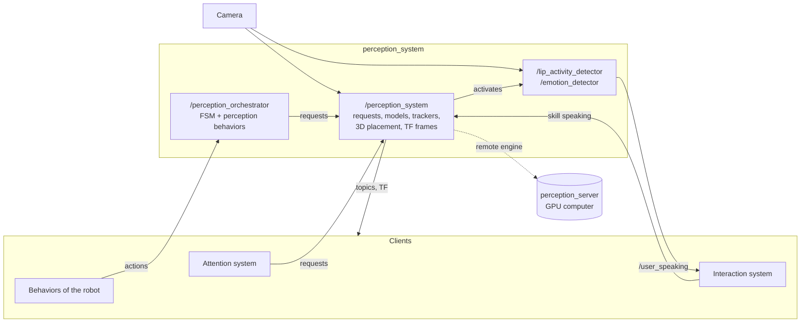

# perception_system


The **perception capability of a robot**, built on ROS 2 and on
[`koch2`](https://github.com/geriabot/koch2) (formerly `behavior_architecture`).

The behaviors of a robot, and its other capabilities, need to know what is around it: the person
the attention system keeps in view, whether the user is speaking, whether there is a cup on the
table, where every chair of the room is. This system serves all of them at once. A client asks for
what it needs (a class to detect and track, a TF frame on an object, a skill such as the lip
activity of the user) and receives it on its own topics and frames, without interfering with the
other clients. Longer tasks (follow an object, wait until something appears, keep a frame on
every object of a class) are actions that end when the client cancels them.

```sh
ros2 action send_goal /perception_system/track_object perception_system_interfaces/action/TrackObject \
  "{class_name: 'person', frame_id: 'target', reacquire: true}" --feedback
```

## The idea

1. **Requests, not configuration.** Nothing is detected until a client asks for it, and every
   request is opened, updated and closed through services. The detection models and the skill
   nodes run only while some request needs them.
2. **One request, one set of outputs.** Each detection request has its own class, its own
   tracker and its own topics (or the root topics, for a client that expects them there), so two
   clients never see each other's classes or ids. Requests with the same model and labels share
   one run of the model per image; a request alone gets exactly what the perception of the
   attention system gave ([evaluation](evaluation/README.md#equivalence-with-the-attention-system)).
3. **Tasks with behavior, streams without it.** What a client consumes continuously (detections,
   frames, whether the user speaks) is served by the sensing node. What has a course and an end
   (search for an object, track it, recover it when it is lost) is a perception behavior, a
   Behavior Tree run by the orchestrator, as in any capability built with `koch2`.
4. **Any model, here or on a server.** The models are interchangeable (OMDet-Turbo,
   Grounding DINO, YOLO, YOLO-World, SAM 3), and run on the robot's computer or on a GPU server.
   A robot without a GPU, or without PyTorch, uses a server.

## Perception as a capability of the robot

The robot is controlled by a layered behavioral control architecture: a finite state machine
(FSM) coordinates the plan of the task and activates, phase by phase, the behaviors of the action
layer, a *behavior forest* of Behavior Trees. The capabilities of the robot (perception,
navigation, interaction, attention) are autonomous subsystems with the same layers inside and a
standard interface. The perception system is one of them:

| Layer | In the perception system |
|---|---|
| Coordination | `/perception_orchestrator`, a `BaseOrchestrator`: one FSM per task in progress |
| Action | The perception behaviors (`track_object`, `wait_for_object`, `observe_class`), each in a pool of `BehaviorRunner`s |
| Capabilities | `/perception_system` (the sensing node: models, trackers, 3D placement, TF frames) and the skill nodes about the user, activated in cascade |
| Interpretation, deliberation | None: no question needs a language model |

For the rest of the robot it has the interface of any capability: its life cycle (activated by
`mission_executor`), its goals (services and actions), its feedback (`/perception_system/status`
and the feedback of the actions) and its results.
[ARCHITECTURE.md](docs/ARCHITECTURE.md) describes the design and why it was chosen.

## What it offers

| Need | Interface |
|---|---|
| Detect and track a class (or several) in every image, in 2D and 3D | `start_detection`, then the request's topics |
| A TF frame on a tracked object, on the midpoint of a group, or on every object of a class | `start_target_frame` (`MODE_SINGLE`, `MODE_GROUP`, `MODE_EACH`) |
| What a request sees now: ids, classes, boxes, positions in `odom` | `get_objects` |
| Is there a cup in view? | `detect_once` |
| The models and the classes of a closed-set model (the 80 of COCO for YOLO) | `list_models` |
| Whether the user is speaking (lip activity), the user's facial expression (experimental) | `start_skill`, `/user_speaking`, `get_user_state` |
| Follow an object, recover it when it is lost | action `track_object` |
| Wait until N objects of a class are in view | action `wait_for_object` |
| A TF frame on every object of a class until cancelled | action `observe_class` |
| The same from a Behavior Tree | the plugin `perception_system_bt_nodes` ([BEHAVIOR_TREES.md](docs/BEHAVIOR_TREES.md)) |

Every service, topic and action, with its types: [ROS_INTERFACES.md](docs/ROS_INTERFACES.md).

## The system



| Package | Contents |
|---|---|
| `perception_system_core/perception_system` | The sensing node `/perception_system`, its Python client, the launch file and the configuration (cameras) |
| `perception_system_core/perception_orchestrator` | The orchestrator `perception_orchestrator` (C++, `koch2`) |
| `perception_system_core/perception_system_interfaces` | The messages, services and actions |
| `perception_system_behaviors` | The Behavior Tree nodes and the perception behaviors |
| `perception_detectors` | The detection models, the tracker and the perception server (no ROS) |
| `perception_user` | The skills about the user: lip activity and facial expression |
| [`detection_3d_estimators`](https://github.com/rodperex/detection_3d_estimators) (`thirdparty.repos`) | The 3D placement of the detections |

## Documentation

Start with [INDEX.md](INDEX.md): every command, with the document that explains it.

| Document | Contents |
|---|---|
| [ARCHITECTURE.md](docs/ARCHITECTURE.md) | The layers, the nodes, how a request and a task are processed, and why |
| [ROS_INTERFACES.md](docs/ROS_INTERFACES.md) | Every service, action, topic and frame |
| [INTEGRATING.md](docs/INTEGRATING.md) | Using it from a behavior, from Python, and from the attention and interaction systems |
| [BEHAVIOR_TREES.md](docs/BEHAVIOR_TREES.md) | The Behavior Tree nodes and the perception behaviors |
| [MODELS.md](docs/MODELS.md) | The detection models and the tracker; adding a model |
| [PERCEPTION_SERVER.md](docs/PERCEPTION_SERVER.md) | Running the models on another computer |
| [USER_PERCEPTION.md](docs/USER_PERCEPTION.md) | The skills about the user and their limits |
| [CONFIGURATION.md](docs/CONFIGURATION.md) | The parameters of every node, and the cameras |
| [LAUNCH_ARGUMENTS.md](docs/LAUNCH_ARGUMENTS.md) | The arguments of `perception_system.launch.py` |
| [INSTALLATION.md](docs/INSTALLATION.md) | Installing with pixi or on a native ROS 2 |
| [evaluation/README.md](evaluation/README.md) | How the system is validated, and how to run the checks |

<details>
<summary>Repository structure</summary>

```text
perception_system/
├── perception_system_core/
│   ├── perception_system/            sensing node, client, launch, config/cameras
│   ├── perception_orchestrator/      orchestrator (koch2), mission config
│   └── perception_system_interfaces/ msg, srv, action
├── perception_system_behaviors/      BT nodes (plugin) and behavior_tree_xml/
├── perception_detectors/             models (backends/), pipeline, tracker, perception server
├── perception_user/                  lip activity and emotion nodes
├── docs/
├── evaluation/                       checks against a synthetic camera, equivalence tools
├── pixi/                             workspace setup and activation scripts
├── pixi.toml, pixi.lock              environments (Jazzy, Lyrical)
├── requirements.txt, activate.sh     native installation
└── thirdparty.repos                  detection_3d_estimators, koch2
```

</details>

## Usage

### Requirements

Linux x86-64, and either [pixi](https://pixi.sh) (any distribution) or ROS 2 Jazzy on Ubuntu
24.04. A GPU is optional: every model runs on a CPU, slowly except YOLO and `color_blobs`.

### Installation

```sh
mkdir -p ~/perception_ws/src && cd ~/perception_ws/src
git clone https://github.com/geriabot/perception_system.git
vcs import < perception_system/thirdparty.repos
cd .. && ./src/perception_system/pixi/setup_workspace.sh
pixi run build
```

Native ROS 2 and Lyrical: [INSTALLATION.md](docs/INSTALLATION.md).

### Quick start

With a camera publishing on `/image_rgb` (and, for 3D, a depth camera on `/rgbd_camera/*`):

```sh
pixi shell
ros2 launch perception_system perception_system.launch.py camera:=rgbd
# in another terminal: a request of its own, then its topics
ros2 service call /perception_system/start_detection perception_system_interfaces/srv/StartDetection \
  "{name: 'demo', class_name: 'person'}"
ros2 topic echo /perception_system/requests/demo/detections_3d
ros2 service call /perception_system/stop perception_system_interfaces/srv/StopRequest "{name: 'demo'}"
```

Without a camera, the synthetic camera of the evaluation and the `color_blobs` model run the whole
system on a CPU ([evaluation/README.md](evaluation/README.md#running-the-checks)).

### Tests

```sh
pixi run test                                     # unit tests (Python)
colcon test --packages-select perception_system_behaviors && colcon test-result --verbose
```

## Credits

The detection pipeline, the perception server and the TF publishers come from the perception of
the [attention system](https://github.com/geriabot/attention_system). The lip activity and emotion
detectors come from the perception of the
[interaction system](https://github.com/geriabot/interaction_system), by Álvaro Quintana Camacho.

## License

Apache-2.0 ([LICENSE](LICENSE)), except `perception_user`, MIT
([perception_user/LICENSE.MIT](perception_user/LICENSE.MIT)). YOLO and YOLO-World use
Ultralytics (AGPL-3.0), installed by the pixi environment; SAM 3 has its own license
([MODELS.md](docs/MODELS.md)).
