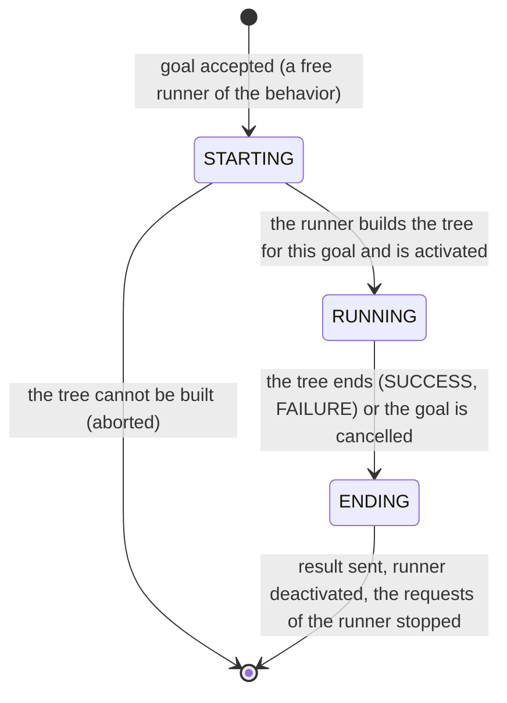

# Architecture: layers, nodes and design

## Perception as a capability with the robot's layers inside

The perception system is built with
[`koch2`](https://github.com/geriabot/koch2) (formerly `behavior_architecture`), the framework of
the behavioral control architecture of the robot, as the attention and the interaction systems are.
The capabilities of the robot are autonomous subsystems that can have the robot's layers inside
and offer a standard interface; the behaviors that need them activate and use them.

| Layer | In the perception system | Code |
|---|---|---|
| Deliberation, planning | Not needed: the goal comes in the request | — |
| Coordination | One FSM per perception task in progress: `STARTING` (the behavior's tree is built), `RUNNING` (feedback), `ENDING` (result, requests closed) | `/perception_orchestrator`, a `BaseOrchestrator` (`perception_orchestrator`) |
| Action | The perception behaviors, one Behavior Tree each: `TrackObject`, `WaitForObject`, `ObserveClass`; a pool of `BehaviorRunner`s per behavior | `perception_system_behaviors/behavior_tree_xml` |
| Capabilities | The sensing node, which serves the requests (models, trackers, 3D placement, frames), and the skill nodes about the user | `/perception_system`, `perception_user` |
| Interpretation | None: no question of the system needs a language model | — |

For the rest of the robot, the perception system has the interface of any capability:

| | What | Interface |
|---|---|---|
| In | Activation | The life cycle of `/perception_orchestrator` (by `mission_executor`), which activates `/perception_system` in cascade |
| In | Goals | The services of `/perception_system` (requests) and the actions of the orchestrator (tasks) |
| Out | Feedback | `/perception_system/status`, and the feedback of each action |
| Out | Results | The responses (the topics of a request), the results of the actions, the topics and TF frames |

### Why this design

- A perception request is a stream: while it is open, every image produces its detections. Many
  clients have one open at the same time (the attention system follows a person while the
  interaction system needs the lips of the user and a behavior looks for a cup). The sensing node
  serves any number of them, each with its own outputs.
- A perception task has a course: search, track, lose, recover, give up. A Behavior Tree
  expresses that course, and the orchestrator runs it as any capability of the architecture runs
  its behaviors, with the same framework, so that its trees can also be used by the behaviors of
  the robot as subtrees ([BEHAVIOR_TREES.md](BEHAVIOR_TREES.md)).
- The models are Python (PyTorch, Hugging Face, Ultralytics, MediaPipe) and process images; the
  orchestrator and the runners are C++ and process no image. The sensing node keeps the models
  and the images in one process, and the orchestrator uses it through its services, as a behavior
  of the robot would.
- Nothing runs while nobody needs it: the model runs only for open requests, a skill node is
  active only while a request needs it, and the orchestrator activates `/perception_system` only
  when it is activated.
- A client may use the requests directly (the attention system does: it has its own trees) or
  ask for a task (a behavior that only needs "follow that person").

## The nodes

| Node | Package | What it does |
|---|---|---|
| `/perception_system` | `perception_system` | The sensing node, a lifecycle node: the requests, the models (local or remote engine), one tracker per request, the 3D placement, the TF frames, the skills, the status |
| `/perception_orchestrator` | `perception_orchestrator` | The FSM of the tasks; its runners `perception_<behavior>_<n>`. Runs in `mission_executor` with the node `/perception_bt_node` of the trees |
| `/lip_activity_detector` | `perception_user` | The skill `speaking`, a lifecycle node activated by `/perception_system` |
| `/emotion_detector` | `perception_user` | The skill `emotion` (experimental), a lifecycle node activated by `/perception_system` |
| `perception_server` | `perception_detectors` | Not a ROS node: an HTTP server that runs the models on another computer |

## A detection request

1. A client calls `start_detection` with a name, a class (or labels), and optionally its model,
   tracker, outputs and namespace. The sensing node opens a pipeline for it (the model, loaded
   once for every request that uses it, and a tracker of its own), and creates its publishers.
   A request with the name of an open one updates it: a new class keeps its tracker and ids.
2. For each camera image, the model runs once for every distinct (model, options, labels) of the
   open requests; each request then merges its class and category, assigns its tracker ids and
   publishes, with the stamp and frame of the image:
   - `detections_2d`: boxes, classes, scores, tracker ids (empty until the track is confirmed);
   - `detections_image`: the image with every tracked detection boxed and labeled with its id;
   - `detections_3d`: each detection placed on the ray of the center of its box, at the distance
     that the estimator of the camera gives (a depth image, a fixed ray, the size of the object,
     or a monocular depth network);
   - `debug_image`, if asked for.
3. The target frames that follow the request are updated with its 3D detections and published
   in the fixed frame (`odom`), with the camera pose at the time of the image and the stamp of the
   image ([target frames](#target-frames)).
4. `stop` ends the request and its frames. Deactivating `/perception_system` ends every request.

A request without a class publishes the camera image on `detections_image` and empty
detections, as the detector of the attention system did before its class was set; the parameter
`startup_requests` opens such requests on activation.

### Several requests, one model run

Requests with the same model, options and labels share the output of the model for an image;
each one still has its own tracker and ids. A request with other labels runs the model again:
an open-vocabulary detector given several texts at once does not give the same boxes as given
each one alone, so merging labels across requests would change what each client gets.
The tracker numbering of each request starts at 1 and does not depend on the others (ByteTrack
numbers its tracks with a counter shared by the process; each tracker keeps its own).

With the remote engine, each request is a session of the perception server, and the image is sent
once per request.

### Target frames

| Mode | Frame | Updated |
|---|---|---|
| `MODE_SINGLE` | `frame_id` at the detection of a class and tracker id | Every image in which that detection is |
| `MODE_GROUP` | `frame_id` at the midpoint of N detections of a class (the first N seen; one missing for 5 images is replaced by another of the class; N ≤ 0: all) | Every image in which the whole group is; also the half width of the group across the line of sight, plus half a body |
| `MODE_EACH` | `<frame_id>_<id>` for every tracked detection of a class (or of every class) | Every image, for the detections in it |

The point of the camera frame is placed in the fixed frame with the camera pose looked up at the
time of the image (waiting up to `tf_lookup_timeout_ms` for it): while the robot turns, the latest
pose would shift the target in the direction of the turn. The frame carries the stamp of the image.

## A perception task

1. A goal arrives on an action of the orchestrator. It is accepted only when `/perception_system`
   is active and a runner of that behavior is free (`slots_per_behavior` runners per behavior, so
   that several clients run the same task at once).
2. The runner gets a tree for this goal: the behavior as a subtree, its inputs written in the
   tree, its outputs in blackboard keys of the runner. The runners share the blackboard of
   `mission_executor`; the keys of each runner keep the goals apart.
3. The tree opens its requests on `/perception_system`, named after the runner
   (`perception_track_object_0`, `perception_track_object_0_frame`). Each control cycle the
   orchestrator reads the status of the runner (`get_bt_status()`), sends feedback (what the tree
   outputs, and the objects of its request from `get_objects`), and ends the goal when the tree
   ends or the goal is cancelled.
4. When the goal ends, the runner is deactivated (its tree halted) and its requests are stopped.

The orchestrator does not use `/behavior_status`: every runner of the robot publishes on that
topic without saying which runner it is, so a capability that ran its runners as the base class
does would take another capability's result as its own. The launch file remaps the topic for the
runners of the perception system, and the orchestrator reads its own runners' status directly.

## Life cycle

- `mission_executor` configures and activates `/perception_orchestrator`. Its control cycle then
  configures and activates `/perception_system` (parameter `manage_perception_system`), and
  accepts goals once it is active.
- Without the orchestrator (`orchestrator:=false`), `/perception_system` activates itself
  (`autostart`), or another node manages its life cycle.
- `/perception_system` loads the default model on activation (`preload_model`), connects to the
  perception server (remote engine), and creates the request services. Deactivating it ends every
  request and deactivates the skill nodes it activated.
- A skill node is activated (configured first if needed) with the first request of its skill and
  deactivated after the last one ends.

## What it does not do

It decides nothing about the robot's motion: a target frame says where something is, and the
attention system or a behavior decides whether to look at it or go there. It recognises no
people by identity (a tracker id lasts while the track does) and answers no question in natural
language; those belong to other capabilities.
